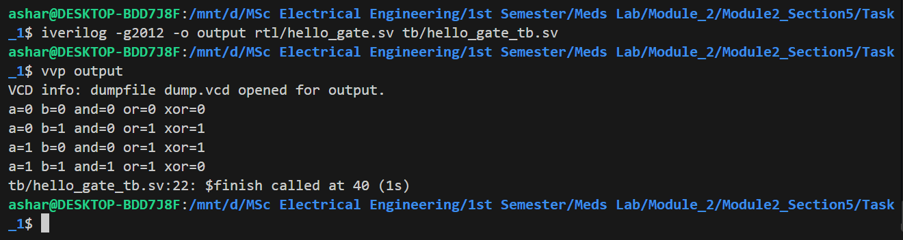
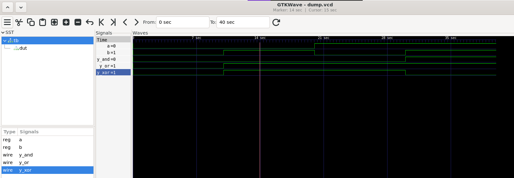

## 1. Schematic Diagram


## 2. Terminal Output Screenshot



## 3. Waveform Screenshot



## 4. Explanation

The design implements AND, OR, and XOR gates using the same two inputs. The testbench applies all four possible input combinations and displays the outputs. The results are compared against the truth table to verify the behavior of each gate.

### 5. Compile Workflow:
The work flow is as follows:

```bash
iverilog -g2012 -o output rtl/hello_gate.sv tb/hello_gate_tb.sv
vvp output
gtkwave dump.vcd
```