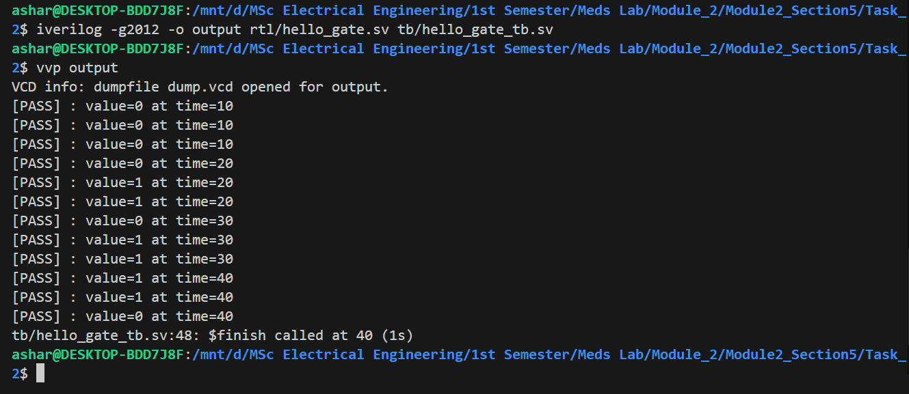

## 1. Schematic Diagram


## 2. Terminal Output Screenshot



## 3. Waveform Screenshot


## 4. Explanation

The design implements AND, OR, and XOR gates using the same two inputs. The testbench manually applies all four possible input combinations and uses a reusable `check()` task to compare the actual outputs with the expected values, printing `[PASS]` or `[FAIL]` for each test. To verify the checker, one expected value can be intentionally changed in the testbench to produce a `[FAIL]` result. The original expected value is then restored before final submission.

### 5. Compile Workflow:
The work flow is as follows:

```bash
iverilog -g2012 -o output rtl/hello_gate.sv tb/hello_gate_tb.sv
vvp output
gtkwave dump.vcd
```