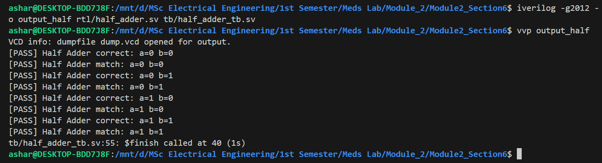
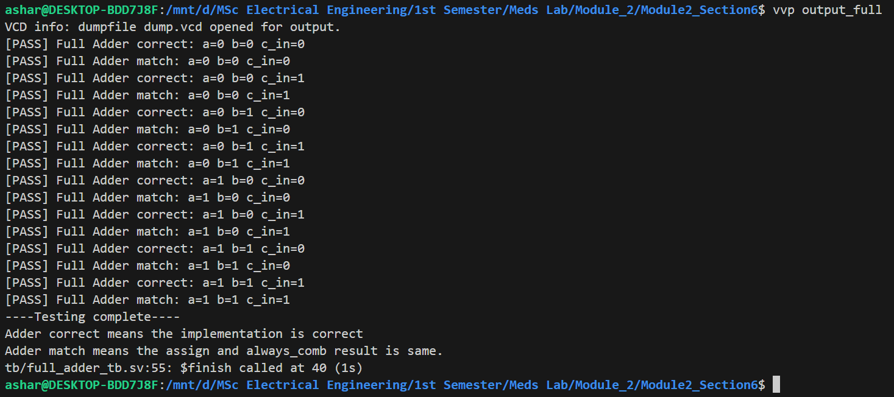
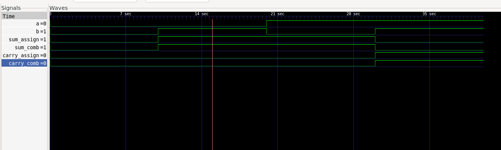
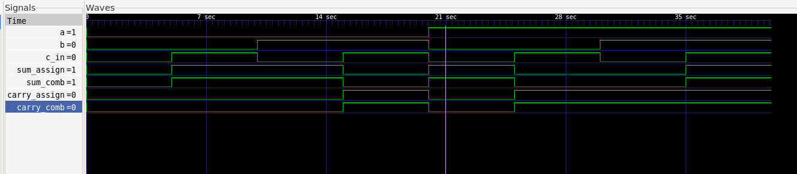

# Task 3: Half Adder and Full Adder

## 1. Schematic Diagrams

### Half Adder


### Full Adder


## 2. Terminal Output

### Half Adder



### Full Adder



## 3. Waveforms

### Half Adder



### Full Adder



## 4. Explanation

### Why do `assign` and `always_comb` synthesize to the same gates?

First, we implemented the half adder using both `assign` and `always_comb` and tested both implementations using testbenches. Next, we implemented the full adder using both methods and tested all eight possible input combinations.

Both versions synthesize to the same logic gates because synthesis tools focus on the logic being described rather than the coding style. Since both implementations describe the same Boolean logic for sum and carry, they produce equivalent hardware, even though one uses continuous assignments and the other uses procedural statements.

### Conclusion

Both implementations produced the expected outputs, and the `assign` and `always_comb` versions matched for all tested input combinations.

### 5. Compile Workflow:
The work flow is as follows:

```bash
iverilog -g2012 -o output rtl/hello_gate.sv tb/hello_gate_tb.sv
vvp output
gtkwave dump.vcd
```