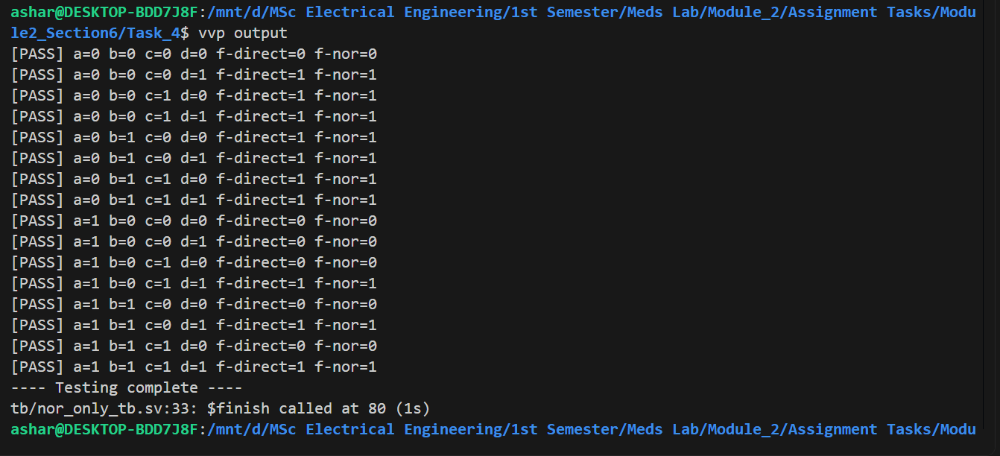

# Task 4: NOR-Only Realization

## 1. Boolean Derivation

The given Boolean function is:

\[
f=(b+c+d)(a'+b+c)(a'+d)
\]

Using De Morgan's theorem:

\[
f=\overline{\overline{(b+c+d)}+\overline{(a'+b+c)}+\overline{(a'+d)}}
\]

The complement of \(a\) is generated using a NOR gate:

\[
na=\overline{a+a}=a'
\]

The intermediate signals are:

\[
n1=\overline{b+c+d}
\]

\[
n2=\overline{na+b+c}
\]

\[
n3=\overline{na+d}
\]

The final output is:

\[
f=\overline{n1+n2+n3}
\]

## 2. Circuit Diagram


## 3. Terminal Output




## 4. Explanation

The function was implemented in two ways. The direct implementation uses the original Boolean expression, while the NOR-only implementation uses the NOR reduction operator (`~|`) to construct the equivalent logic.

A self-checking testbench tests all 16 possible combinations of inputs `a`, `b`, `c`, and `d`. Both implementations are checked against the expected output calculated from the original expression.

### Conclusion

Both implementations should produce the same output for all 16 input combinations. The testbench verifies the correctness of the NOR-only implementation by comparing its output with the direct implementation and the expected Boolean result.

## 5. Compile Workflow

The workflow is as follows:

```bash
iverilog -g2012 -s tb -o output_nor rtl/nor_only.sv tb/nor_realization_tb.sv
vvp output_nor
```