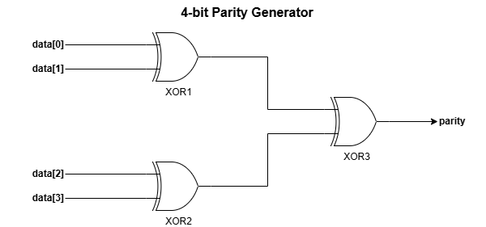
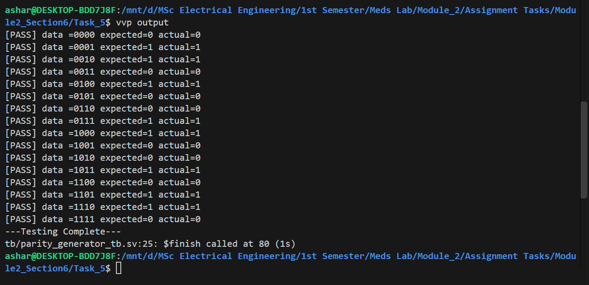
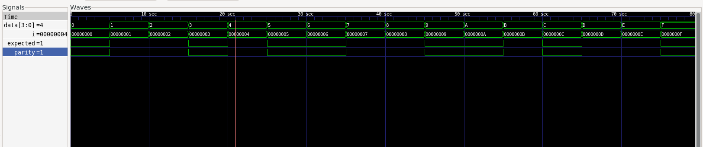

# Task 5: 4-bit Parity Generator

## 1. Schematic Diagram



## 2. Terminal Output



## 3. Waveform



## 4. Explanation

The parity generator takes a 4-bit input, `data[3:0]`, and produces a 1-bit output, `parity`. It is implemented using a single continuous assignment with the reduction XOR operator (`^`).

The testbench exhaustively checks all 16 possible input combinations. It calculates the expected parity using `$countones(data) % 2` and compares it with the actual output using case inequality (`!==`).

### Conclusion

All 16 input combinations passed the testbench checks. The simulation confirms that the reduction XOR implementation produces `1` for an odd number of high bits and `0` for an even number of high bits.

## 5. Compile Workflow

The workflow is as follows:

```bash
iverilog -g2012 -s tb -o output_parity rtl/parity_generator.sv tb/parity_generator_tb.sv
vvp output_parity
gtkwave dump.vcd
```