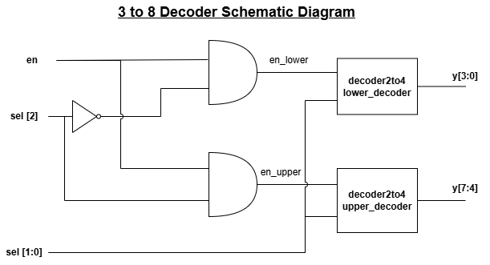
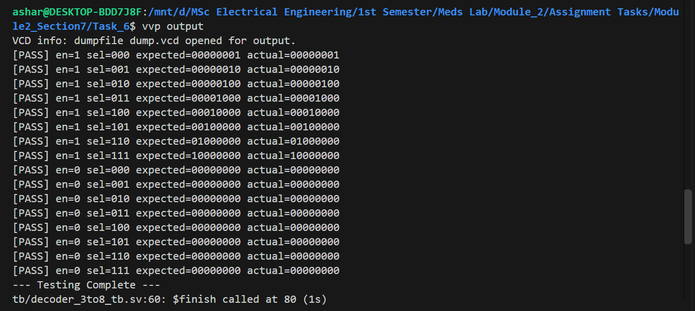
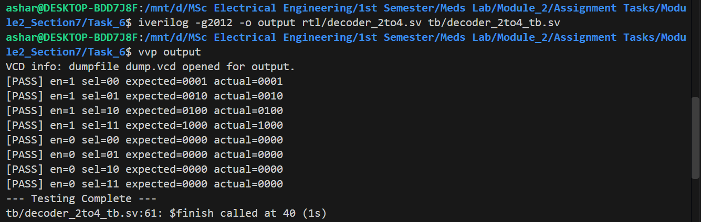
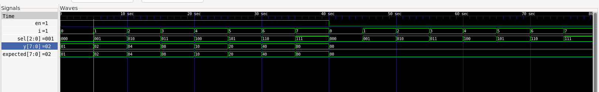
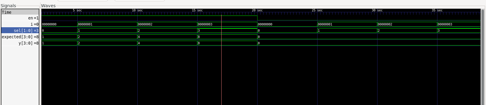

# Task 6: 3-to-8 Decoder from 2-to-4 Decoders

## 1. Schematic Diagram



## 2. Terminal Output
Terminal output for 3 to 8 decoder


Terminal output for 2 to 4 decoder


## 3. Waveform
Waveform of 3 to 8 decoder


Waveform of 2 to 4 decoder


## 4. Explanation

The 3-to-8 decoder is implemented using two instances of the 2-to-4 decoder and additional enable-selection glue logic. The most significant select bit, `sel[2]`, determines which decoder is enabled, while `sel[1:0]` selects one of the four outputs within that decoder.

The testbenches verify the standalone 2-to-4 decoder and also test all 8 combinations of the 3-to-8 decoder with enable signal 1. They also confirm that all outputs remain zero when enable signal is 0.


## 5. Compile Workflow

The workflow for testing the 2-to-4 decoder is:

```bash
iverilog -g2012 -s tb -o output_2to4 rtl/decoder_2to4.sv tb/decoder_2to4_tb.sv
vvp output_2to4
gtkwave dump.vcd
```

The workflow for testing the 3-to-8 decoder is:

```bash
iverilog -g2012 -s tb -o output_3to8 rtl/decoder_2to4.sv rtl/decoder_3to8.sv tb/decoder_3to8_tb.sv
vvp output_3to8
gtkwave decoder3to8.vcd
```