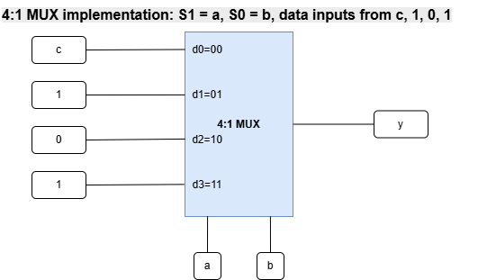
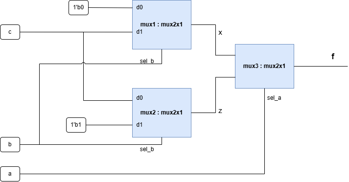
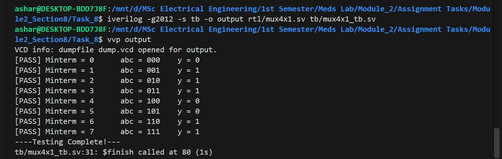
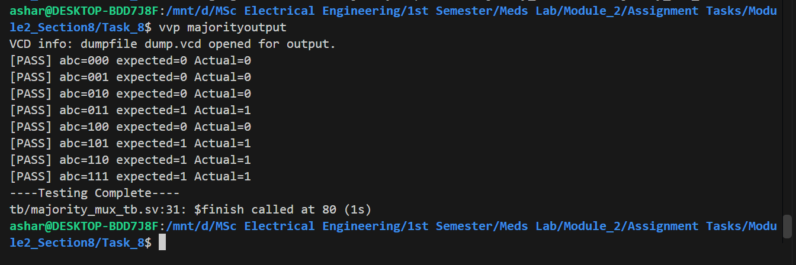
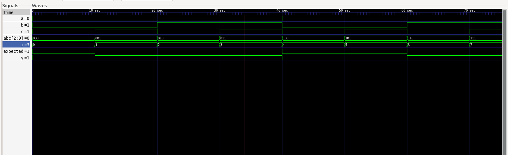
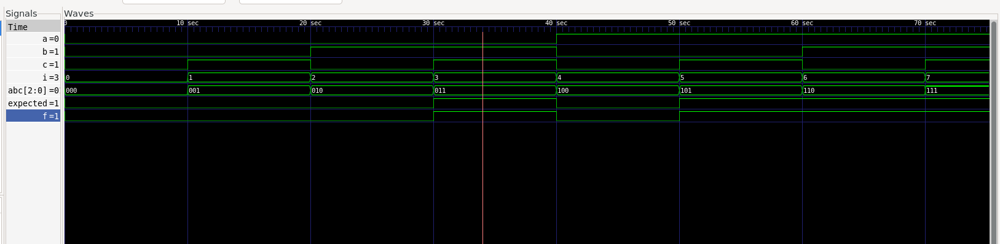
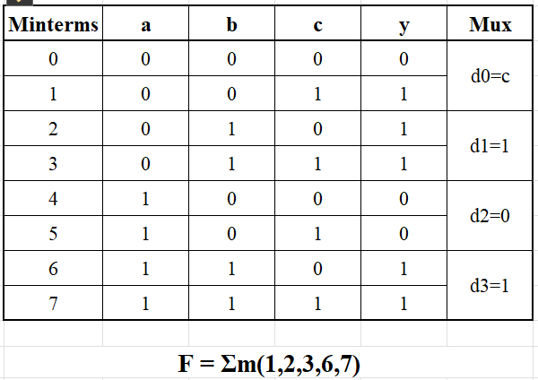

# Task 8: Boolean Function and Majority Function Using Multiplexers

## 1. Schematic Diagram

### Part A: 4:1 MUX Implementation



### Part B: 3-bit Majority Function Using Cascaded 2:1 MUXes



## 2. Terminal Output

### Part A: 4:1 MUX



### Part B: Majority Function



## 3. Waveform

### Part A: 4:1 MUX



### Part B: Majority Function



## 4. TruthTable

The truth table for this Boolean function `F(a,b,c) = Σm(1,2,3,6,7)`



## 5. Explanation

### Part A: Boolean Function Using a 4:1 MUX

The Boolean function `F(a,b,c) = Σm(1,2,3,6,7)` is implemented using a 4:1 multiplexer. Inputs `a` and `b` serve as the select lines, while the data inputs are assigned as `d0=c`, `d1=1`, `d2=0`, and `d3=1`.

### Part B: 3-bit Majority Function Using Cascaded 2:1 MUXes

The majority function produces an output of `1` whenever at least two of the three inputs (`a`, `b`, `c`) are high. Its Boolean expression is `F = ab + ac + bc`.

The circuit is implemented using three cascaded 2:1 multiplexers. The first MUX selects between `0` and `c`, the second selects between `c` and `1`, and the third selects between their outputs using `a` as the select signal.

A reusable 2:1 MUX module is implemented using `always_comb` and a `case` statement. The testbench verifies all 8 input combinations using the independent reference expression `(a & b) | (a & c) | (b & c)`.

### Conclusion

Both implementations passed all 8 test cases. The simulations confirm that the 4:1 MUX correctly realizes the specified Boolean function and that the cascaded 2:1 MUX network correctly implements the 3-bit majority function.

## 6. Compile Workflow

### Part A: 4:1 MUX

```bash
iverilog -g2012 -s tb -o output_mux rtl/mux4x1.sv tb/mux4x1_tb.sv
vvp output_mux
gtkwave dump.vcd
```

### Part B: Majority Function

```bash
iverilog -g2012 -s tb -o output_majority rtl/majority_mux.sv tb/majority_mux_tb.sv
vvp output_majority
gtkwave dump.vcd
```
