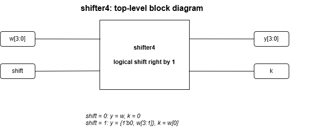
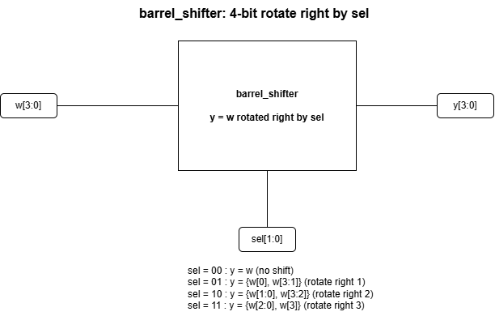
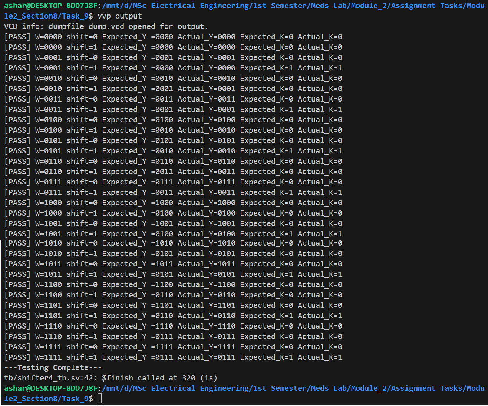
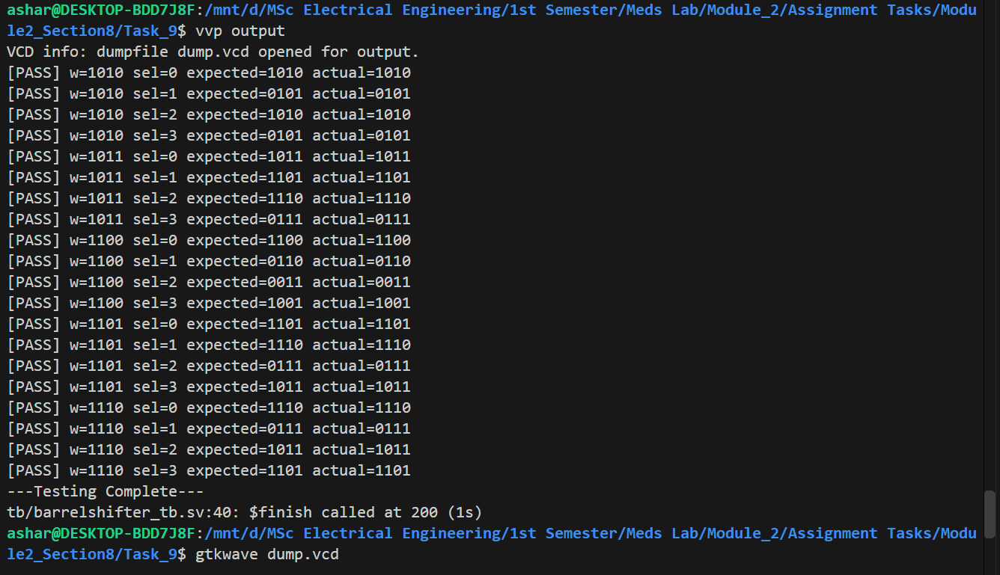
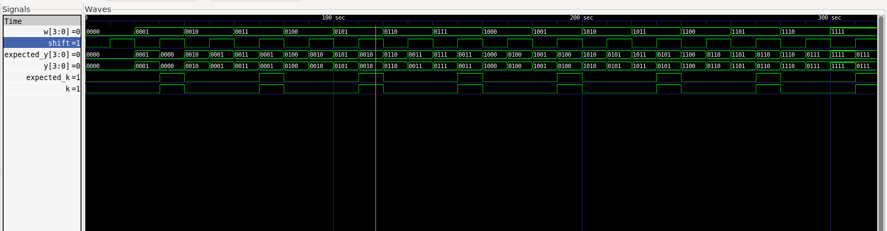
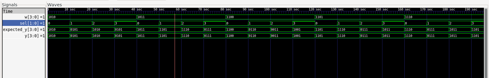

# Task 9: 4-bit Shifter and Barrel Shifter

## 1. Schematic Diagram

### Part A: 4-bit Right Shifter


### Part B: 4-bit Barrel Shifter


## 2. Terminal Output

### Part A: 4-bit Right Shifter



### Part B: 4-bit Barrel Shifter



## 3. Waveform

### Part A: 4-bit Right Shifter



### Part B: 4-bit Barrel Shifter



## 4. Explanation

### Part A: 4-bit Right Shifter

This circuit takes a 4-bit input `w` and shifts it one position to the right when `shift=1`. When `shift=0`, the output stays the same. The shifted-out bit is stored in `k`. The design uses ternary operators (`?:`).

The testbench checks both values of `shift` with different inputs and compares the actual and expected outputs.

### Part B: 4-bit Barrel Shifter

This circuit rotates a 4-bit input to the right by 0, 1, 2, or 3 positions depending on `sel`. 

The design uses a `unique case` statement. The `unique case` statement helps detect multiple case matches during simulation. However, I am using Icarus Verilog. It showed warning that it ignores some checks, so I verified the output using our testbench.

The testbench checks all four values of `sel` with different input values. The expected output is calculated using shift operations and compared with the actual output.

### Conclusion

Both parts were tested successfully. The simulation results show that the right shifter and barrel shifter give the expected outputs.

## 5. Compile Workflow

### Part A

```bash
iverilog -g2012 -s tb -o output rtl/shifter4.sv tb/shifter4_tb.sv
vvp output
gtkwave dump.vcd
```

### Part B

```bash
iverilog -g2012 -s tb -o output rtl/barrelshifter.sv tb/barrelshifter_tb.sv
vvp output
gtkwave dump.vcd
```
