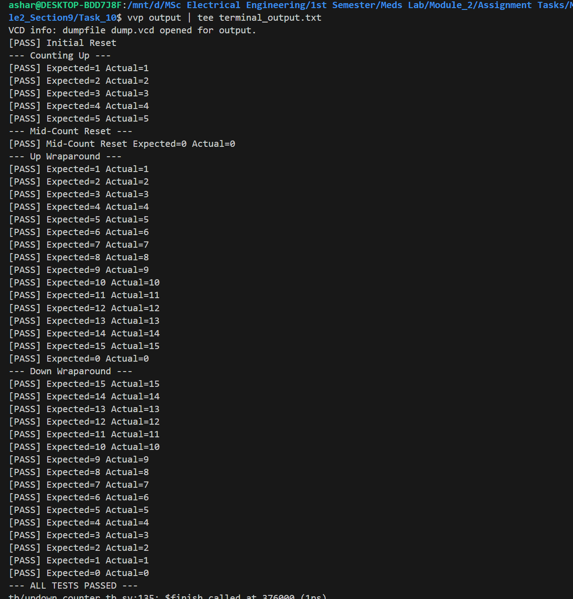
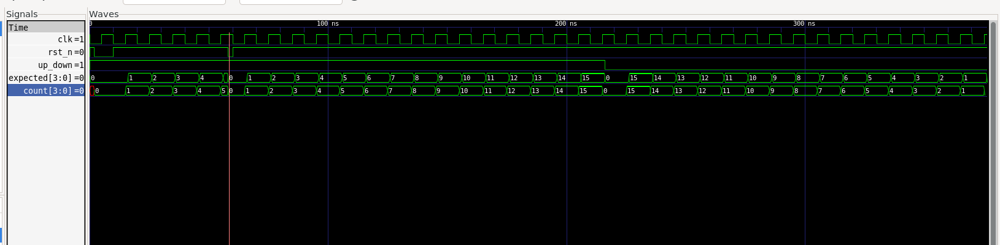

# Task 10: 4-bit Up-Down Counter with Asynchronous Reset

## 1. Schematic Diagram


## 2. Terminal Output



## 3. Waveform



## 4. Explanation

This task implements a 4-bit up-down counter with an active-low asynchronous reset. The counter increases when `up_down=1` and decreases when `up_down=0`, on every positive clock edge.

When `rst_n=0`, the counter resets to zero immediately without waiting for a clock edge. Since the counter is 4 bits, it wraps from 15 to 0 while counting up and from 0 to 15 while counting down.

The testbench checks the initial reset, counting in both directions, reset during counting, and wraparound. The expected values are compared with the actual output using `!==`.

### Conclusion

All 39 test checks passed successfully. The waveform also confirms that the counter resets between clock edges and counts correctly in both directions.

## 5. Compile Workflow

```bash
iverilog -g2012 -s tb -o output rtl/up_down_counter.sv tb/updown_counter_tb.sv
vvp output
gtkwave dump.vcd
```